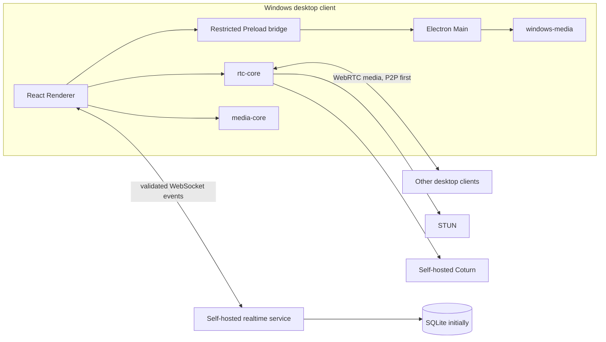
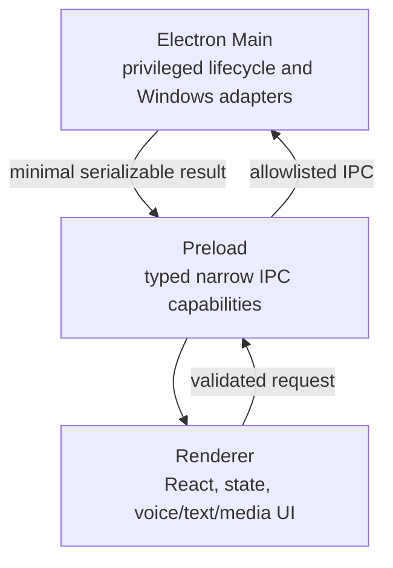
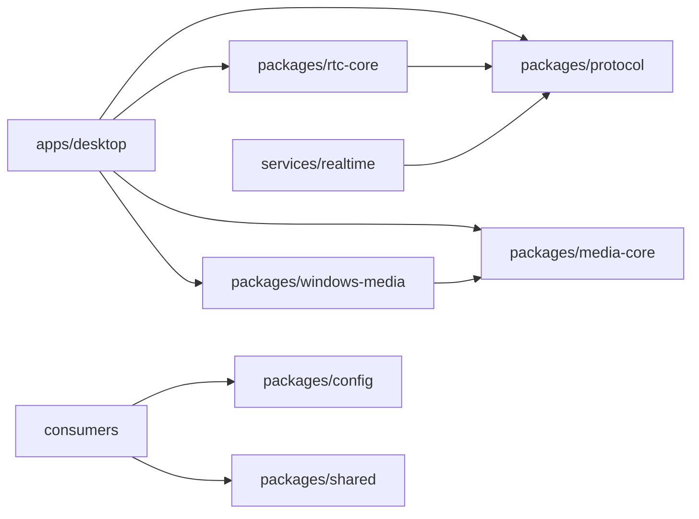

# Target architecture

> This document describes the intended architecture. The Electron desktop shell (T1) and the
> realtime connection/protocol foundation (T2) are implemented; see
> [`tasks/STATUS.md`](tasks/STATUS.md) for what remains a marker or is not yet started. Treat any
> capability this document describes as unimplemented unless STATUS.md says otherwise.

## System context



Electron Main owns privileged lifecycle and platform integration. Preload exposes a narrow,
capability-oriented bridge. The sandboxed Renderer owns React UI and application orchestration.
Generic RTC and media behavior stay outside desktop composition; Windows capture stays outside
generic packages.

## Client process boundary



The Renderer never receives raw `ipcRenderer`, filesystem, shell, process, or native-helper access.
Main validates the sender/frame and runtime-validates every privileged request. Media permissions
are deny-by-default and tied to an expected origin, frame, media kind, and user gesture.

## Network boundary

```text
Desktop clients
     |
     +-- WebSocket --> realtime service
     |                  +-- connection/session handling
     |                  +-- presence
     |                  +-- voice signaling
     |                  +-- text chat
     |                  `-- protocol handlers
     |
     `-- WebRTC -------> peer clients (P2P first)
                        +-- STUN discovery
                        +-- TURN relay fallback
                        `-- future SFU transport
```

Voice signaling and text may start in one deployable service, but remain internal modules. The
service never becomes a media relay. WebRTC data channels are not the text-chat persistence path.

## Workspace ownership

| Workspace                | Target ownership                                                         | Must not own or depend on                                |
| ------------------------ | ------------------------------------------------------------------------ | -------------------------------------------------------- |
| `apps/desktop`           | Electron Main, Preload, Renderer, window lifecycle, desktop composition  | Generic RTC algorithms or Windows capture implementation |
| `services/realtime`      | WebSocket connections, presence, voice signaling, text events            | Media payload relay or UI logic                          |
| `packages/protocol`      | Canonical runtime schemas, derived types, message/version contracts      | Desktop/server implementations                           |
| `packages/rtc-core`      | Environment-neutral peer/session transport, tracks, ICE, stats, recovery | Electron, React, Windows APIs, `windows-media`           |
| `packages/media-core`    | Semantic source ownership and generic media lifecycle                    | Electron/native Windows implementation                   |
| `packages/windows-media` | System/process loopback and any native/helper adapters                   | Generic UI or signaling behavior                         |
| `packages/config`        | Typed parsing and validation for configuration                           | Secrets, implicit production defaults                    |
| `packages/shared`        | Small stable primitives with multiple real consumers                     | Domain dumping ground                                    |

Preferred dependency direction:



Edges are introduced only when real code needs them. The diagram is a direction guardrail, not a
requirement to create speculative dependencies. `pnpm verify:architecture` checks the highest-risk
forbidden imports and should expand when real boundaries appear.

## Realtime service strategy

T2 implemented the connection/protocol-handling foundation of the first deployable, using `ws` for
the WebSocket server and `zod` for runtime message/config validation (see
[`references/VERSION_DECISIONS.md`](references/VERSION_DECISIONS.md) for why). Every inbound
message is decoded and runtime-validated at one boundary
(`packages/protocol`'s `parseClientMessage`) before a connection-state check dispatches it; nothing
reaches domain logic unvalidated. The shared protocol package is canonical; client/server
hand-written copies are prohibited. Full protocol design:
[`architecture/REALTIME_PROTOCOL.md`](architecture/REALTIME_PROTOCOL.md).

Presence, voice-signaling, and text-chat remain unimplemented internal modules for later tasks
(T3+, T7) to add alongside the connection module T2 built:

```text
services/realtime/src/
  connection.ts, connection-state.ts   # T2 — implemented
  protocol-handlers.ts, heartbeat.ts   # T2 — implemented
  rate-limiter.ts, config.ts, logging.ts, server.ts, index.ts   # T2 — implemented
  presence/          # not yet implemented
  voice-signaling/    # not yet implemented
  text-chat/          # not yet implemented
```

Bounding message size/rate is implemented (`REALTIME_MAX_MESSAGE_BYTES`,
`REALTIME_RATE_LIMIT_MAX_MESSAGES`/`_WINDOW_MS`); associating a message with an _authorized_
session is not — T2 has no authentication/session model, only a non-authoritative
`connectionId`. That association is deferred to whichever task introduces accounts/sessions.

## Persistence strategy

SQLite is the initial target for text channels, messages, and basic server configuration when T7
needs persistence. Domain services should depend on a narrow storage interface, with SQLite as one
adapter. The interface should reflect required operations and transactions—not mirror SQLite or
prematurely emulate PostgreSQL. A PostgreSQL adapter remains possible later.

No application schema or database code exists in T0.

## RTC transport strategy

The first media path is P2P, likely a small-room mesh. Screen sharing fan-out makes an SFU valuable
at larger participant counts, so UI/application state must talk in terms of participants and
semantic publications rather than peer-mesh internals.

Conceptual, non-binding seam:

```ts
type MediaSourceKind = 'microphone' | 'camera' | 'screen-video' | 'screen-audio';

interface RtcTransport {
  connect(session: SessionDescriptor): Promise<void>;
  publish(source: MediaPublication): Promise<PublicationId>;
  unpublish(publicationId: PublicationId): Promise<void>;
  close(): Promise<void>;
}
```

T3 must refine this against a real vertical slice. Do not add this exact interface merely because
it appears here. Preserve the seam: mesh-specific peer creation, transceivers, negotiation, and
fan-out must not leak into React components.

## Semantic media-source model

```text
microphone    independent audio source
camera        independent video source
screen-video  selected monitor/window video source
screen-audio  optional system or process-tree audio source
```

The target supports all four simultaneously. A camera track must not be replaced by a screen track;
starting or stopping screen capture must not stop voice. Track end, mute, source replacement, and
cleanup belong to the source/transport lifecycle, while UI observes semantic state.

## Windows audio stages

1. **SystemLoopbackAudioCapture:** initial Windows 10/11 path, using documented Electron/Chromium
   system loopback where suitable. It captures the output endpoint mix, not the selected window.
2. **ProcessLoopbackAudioCapture:** later process-tree capture using supported Windows APIs or a
   justified helper. The Microsoft API requires build 20348+, which means practical client support
   is Windows 11; runtime capability detection is mandatory.

Both stay behind `packages/windows-media`. T9 decides native addon versus isolated helper after a
Windows spike. UI receives opaque targets/capabilities, never raw PIDs or generic command execution.
See [`references/WINDOWS_MEDIA.md`](references/WINDOWS_MEDIA.md).

## Deployment shape

- Desktop clients connect to one self-hosted realtime URL.
- SQLite initially lives with the realtime service and is backed up operationally.
- Coturn is an independent network service with short-lived credentials minted server-side.
- A reverse proxy may terminate HTTPS/WSS; TURN needs direct or L4-aware exposure.
- Core operation cannot require vendor SaaS.

## Decisions versus hypotheses

Accepted foundation decisions are recorded in [`adr/`](adr/). Library selection details, protocol
shapes, native-helper form, room-size thresholds, auth model, and SFU choice remain hypotheses for
their implementation tasks. Later engineers should test reality and create or supersede ADRs rather
than treating examples in this document as finished design.
