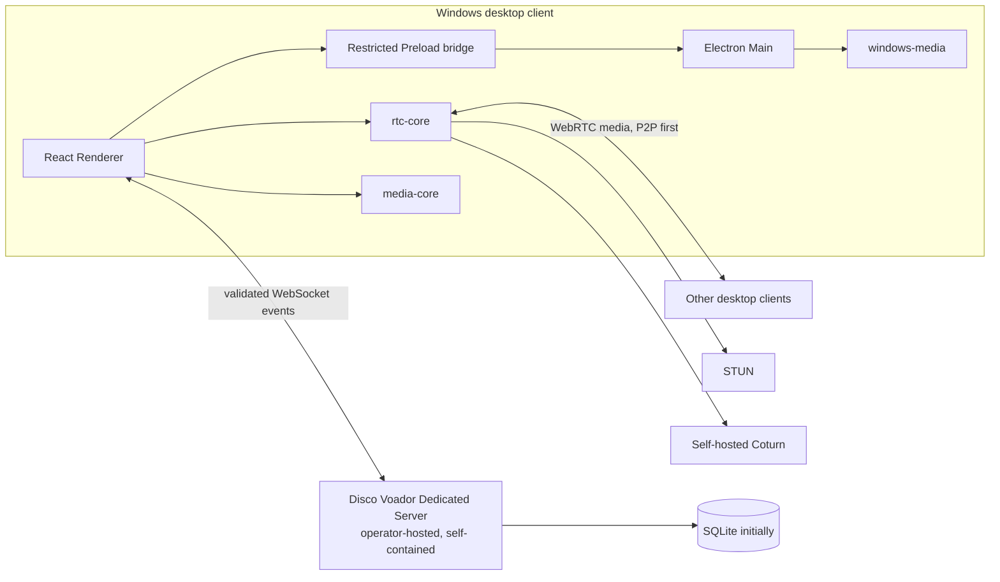
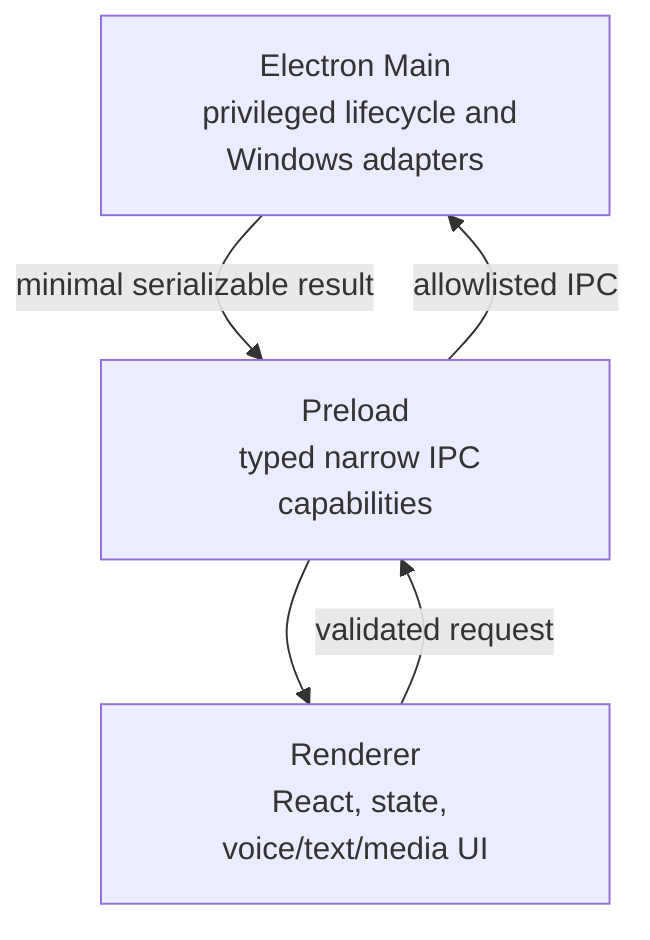
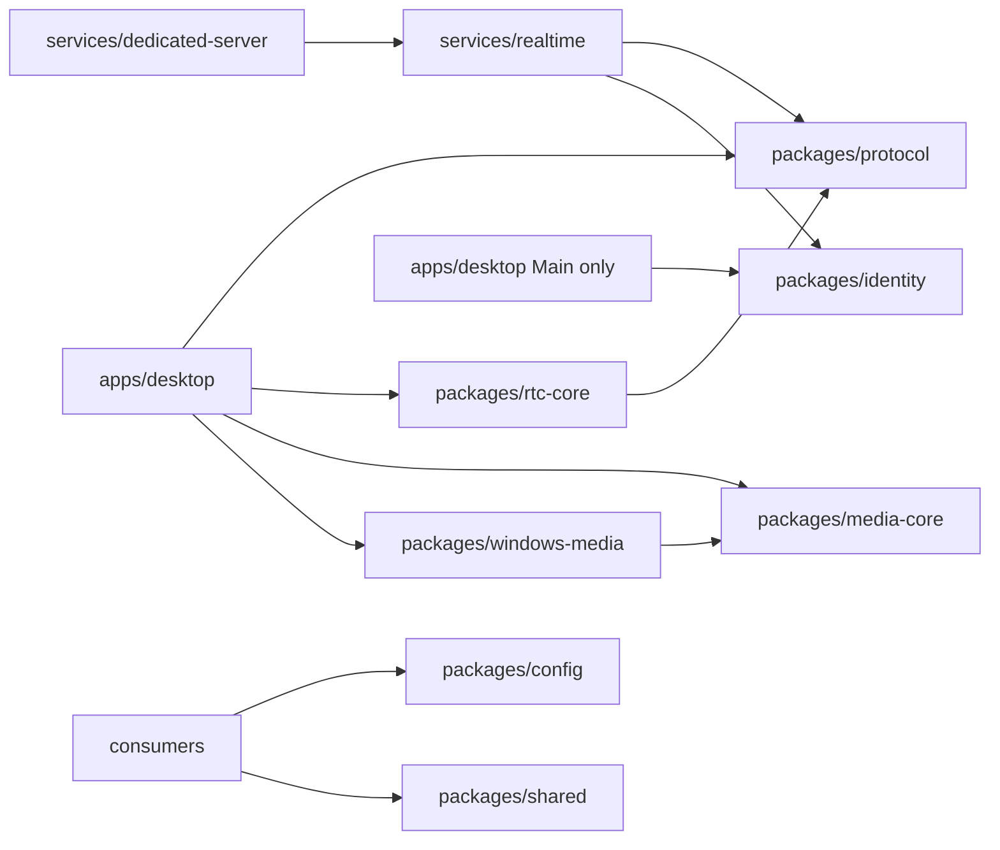

# Target architecture

> This document describes the intended architecture. The Electron desktop shell (T1), the realtime
> connection/protocol foundation (T2), voice channels/microphone/P2P WebRTC (T3), camera streaming
> (T4), screen/window video sharing (T5), screen/system audio (T6), local cryptographic client
> identity (T7), the Dedicated Server product boundary (T8), server-local authorization (T9),
> persistent server-side text chat (T10), local device management/bookmarks/automatic reconnect
> (T11), Windows per-application audio capture (T12), and the Renderer's visual/interaction
> foundation (T13.1) are implemented and live-verified — see
> [`tasks/T3_VOICE_WEBRTC.md`](tasks/T3_VOICE_WEBRTC.md),
> [`tasks/T4_CAMERA_STREAMING.md`](tasks/T4_CAMERA_STREAMING.md),
> [`tasks/T5_SCREEN_SHARE.md`](tasks/T5_SCREEN_SHARE.md),
> [`tasks/T6_SCREEN_AUDIO.md`](tasks/T6_SCREEN_AUDIO.md),
> [`tasks/T7_LOCAL_IDENTITY.md`](tasks/T7_LOCAL_IDENTITY.md),
> [`tasks/T8_DEDICATED_SERVER.md`](tasks/T8_DEDICATED_SERVER.md),
> [`tasks/T9_SERVER_AUTHORIZATION.md`](tasks/T9_SERVER_AUTHORIZATION.md),
> [`tasks/T10_PERSISTENT_TEXT_CHAT.md`](tasks/T10_PERSISTENT_TEXT_CHAT.md),
> [`tasks/T11_DAILY_USE_UX.md`](tasks/T11_DAILY_USE_UX.md),
> [`tasks/T12_WINDOWS_PROCESS_AUDIO.md`](tasks/T12_WINDOWS_PROCESS_AUDIO.md), and
> [`tasks/T13_1_VISUAL_FOUNDATION.md`](tasks/T13_1_VISUAL_FOUNDATION.md). See
> [`tasks/STATUS.md`](tasks/STATUS.md) for what remains a marker or is not yet started. Treat any
> capability this document describes as unimplemented unless STATUS.md says otherwise.

## System context



The client connects directly to an operator-chosen Dedicated Server address (T8) — there is no
Disco Voador–operated infrastructure between them. `services/dedicated-server` is the product/
process the operator runs; it composes `services/realtime`'s reusable connection/session library.
See [`architecture/DEDICATED_SERVER.md`](architecture/DEDICATED_SERVER.md).

Electron Main owns privileged lifecycle and platform integration. Preload exposes a narrow,
capability-oriented bridge. The sandboxed Renderer owns React UI and application orchestration.
Generic RTC and media behavior stay outside desktop composition; Windows capture stays outside
generic packages.

## Client process boundary



The Renderer never receives raw `ipcRenderer`, filesystem, shell, process, or native-helper access.
Main validates the sender/frame and runtime-validates every privileged request. Media permissions
are deny-by-default and tied to an expected origin, frame, media kind, and user gesture.

### Renderer UI foundation

T13.1 established the Renderer's visual/interaction layer: design tokens and CSS Modules for
styling, `lucide-react` for icons, and a `ui/` (generic primitives) / `shell/` (server-picker,
connected-workspace root) / `workspace/` (channel sidebar, chat, member panel, controls) component
layering — all inside `apps/desktop/src/renderer/`, with no new IPC channel, no new persistence, and
`use-voice-channel.ts` remaining the sole owner of WebSocket/RTC/identity-signing state (presentation
components consume it as props, never duplicate it). See
[`architecture/PRODUCT_UI_FOUNDATION.md`](architecture/PRODUCT_UI_FOUNDATION.md) for the full design
record and [`adr/0018-renderer-ui-foundation-css-modules-and-component-layering.md`](adr/0018-renderer-ui-foundation-css-modules-and-component-layering.md)
for the decision.

## Network boundary

```text
Desktop clients
     |
     +-- WebSocket --> realtime service
     |                  +-- connection/session handling
     |                  +-- presence
     |                  +-- voice signaling
     |                  +-- text chat
     |                  `-- protocol handlers
     |
     `-- WebRTC -------> peer clients (P2P first)
                        +-- STUN discovery
                        +-- TURN relay fallback
                        `-- future SFU transport
```

Voice signaling and text may start in one deployable service, but remain internal modules. The
service never becomes a media relay. WebRTC data channels are not the text-chat persistence path.

## Workspace ownership

| Workspace                   | Target ownership                                                                                                                                                                                                                                                           | Must not own or depend on                                                                                                                                                                      |
| --------------------------- | -------------------------------------------------------------------------------------------------------------------------------------------------------------------------------------------------------------------------------------------------------------------------- | ---------------------------------------------------------------------------------------------------------------------------------------------------------------------------------------------- |
| `apps/desktop`              | Electron Main, Preload, Renderer, window lifecycle, desktop composition                                                                                                                                                                                                    | Generic RTC algorithms or Windows capture implementation                                                                                                                                       |
| `services/dedicated-server` | The OvniChat Dedicated Server product: config loading, composition root, CLI/process entrypoint, server identity/capabilities, server-local authorization (groups/tokens/bans, SQLite-backed, T9), persistent chat history (server-wide + per-channel, SQLite-backed, T10) | Protocol/session logic (composes `services/realtime` instead of duplicating it), Electron/Renderer                                                                                             |
| `services/realtime`         | Reusable WebSocket connection/session library: connections, presence, voice signaling, text events                                                                                                                                                                         | Media payload relay, UI logic, product/process/authorization/chat storage concerns (owned by `services/dedicated-server`; only narrow injected `AuthorizationPort`/`ChatPort` seams live here) |
| `packages/protocol`         | Canonical runtime schemas, derived types, message/version contracts                                                                                                                                                                                                        | Desktop/server implementations, crypto (`node:crypto`)                                                                                                                                         |
| `packages/identity`         | Ed25519 keygen/sign/verify/identityId derivation (Node-only)                                                                                                                                                                                                               | Renderer/Preload, environment-neutral packages                                                                                                                                                 |
| `packages/rtc-core`         | Environment-neutral peer/session transport, tracks, ICE, stats, recovery                                                                                                                                                                                                   | Electron, React, Windows APIs, `windows-media`                                                                                                                                                 |
| `packages/media-core`       | Semantic source ownership and generic media lifecycle                                                                                                                                                                                                                      | Electron/native Windows implementation                                                                                                                                                         |
| `packages/windows-media`    | System/process loopback and any native/helper adapters                                                                                                                                                                                                                     | Generic UI or signaling behavior                                                                                                                                                               |
| `packages/config`           | Typed parsing and validation for configuration                                                                                                                                                                                                                             | Secrets, implicit production defaults                                                                                                                                                          |
| `packages/shared`           | Small stable primitives with multiple real consumers                                                                                                                                                                                                                       | Domain dumping ground                                                                                                                                                                          |

Preferred dependency direction:



Edges are introduced only when real code needs them. The diagram is a direction guardrail, not a
requirement to create speculative dependencies. `pnpm verify:architecture` checks the highest-risk
forbidden imports and should expand when real boundaries appear.

## Realtime service strategy

T2 implemented the connection/protocol-handling foundation of the first deployable, using `ws` for
the WebSocket server and `zod` for runtime message/config validation (see
[`references/VERSION_DECISIONS.md`](references/VERSION_DECISIONS.md) for why). Every inbound
message is decoded and runtime-validated at one boundary
(`packages/protocol`'s `parseClientMessage`) before a connection-state check dispatches it; nothing
reaches domain logic unvalidated. The shared protocol package is canonical; client/server
hand-written copies are prohibited. Full protocol design:
[`architecture/REALTIME_PROTOCOL.md`](architecture/REALTIME_PROTOCOL.md).

Voice signaling was added in T3 alongside the connection module T2 built; T7 added the identity-
challenge step to the same connection module. T8 turned this module into the product a self-hoster
actually runs: `services/dedicated-server` composes `services/realtime`'s `createRealtimeServer`
with an operator-configured voice-channel catalog and server display identity, rather than
`services/realtime` itself growing product/process concerns — see
[`architecture/DEDICATED_SERVER.md`](architecture/DEDICATED_SERVER.md) and
[`adr/0012-dedicated-server-product-boundary.md`](adr/0012-dedicated-server-product-boundary.md) for
the full composition decision. T9 added one more injected seam the same way: `services/realtime`
depends only on a narrow `AuthorizationPort` interface (defaulting to a permissive no-op), while the
actual SQLite-backed authorization store lives entirely in `services/dedicated-server` — see
[`architecture/SERVER_AUTHORIZATION.md`](architecture/SERVER_AUTHORIZATION.md). T10 added a second,
identically-shaped seam for persistent chat: `ChatPort` (`services/realtime/src/chat-port.ts`),
implemented by `services/dedicated-server`'s own SQLite-backed `ChatStore` — see
[`architecture/PERSISTENT_TEXT_CHAT.md`](architecture/PERSISTENT_TEXT_CHAT.md). Presence beyond raw
connection lifecycle remains an unimplemented internal module for a later task:

```text
services/realtime/src/
  connection.ts, connection-state.ts   # T2, extended T7/T9/T10 — implemented
  protocol-handlers.ts, heartbeat.ts   # T2, extended T7/T9/T10 — implemented
  rate-limiter.ts, config.ts, logging.ts, server.ts, index.ts   # T2, extended T7/T9/T10 — implemented
  voice/catalog.ts, voice/registry.ts  # T3, extended T10 — implemented
  authorization-port.ts                # T9 — implemented
  chat-port.ts                         # T10 — implemented
  presence/          # not yet implemented
```

Bounding message size/rate is implemented (`REALTIME_MAX_MESSAGE_BYTES`,
`REALTIME_RATE_LIMIT_MAX_MESSAGES`/`_WINDOW_MS`); associating a message with an _authenticated_
identity is now implemented too (T7) — every connection must complete a signed challenge/response
proving possession of its claimed Ed25519 keypair before it can do anything, and the server always
derives `identityId` itself from the verified public key rather than trusting a client-supplied
value. What remains deferred is _authorization_ (server-local permissions/groups/bans keyed by
`identityId`) — that's T9, not T7.

## Persistence strategy

SQLite is the initial target for text channels, messages, and basic server configuration when a
later task (T9 onward) needs persistence. Domain services should depend on a narrow storage
interface, with SQLite as one adapter. The interface should reflect required operations and
transactions—not mirror SQLite or prematurely emulate PostgreSQL. A PostgreSQL adapter remains
possible later.

T7's client identity is deliberately **not** SQLite-backed: it is a single JSON file per profile
(`%APPDATA%/DiscoVoador/identity/identity.json`, atomic writes, `safeStorage`-encrypted private
key) owned entirely by the Electron Main process, with no server-side persistence at all — the
realtime server holds identity state only for a connection's lifetime.

T9 is the first task to introduce real application persistence: the Dedicated Server's authorization
store (groups, memberships, token digests, bans) at `<dataDir>/authorization.sqlite`, via `node:sqlite`'s
built-in `DatabaseSync` — zero new dependencies, and synchronous, matching `services/realtime`'s
existing fully-synchronous connection state machine (see
[`architecture/SERVER_AUTHORIZATION.md`](architecture/SERVER_AUTHORIZATION.md) and
[`adr/0013-server-authorization-storage-and-rbac.md`](adr/0013-server-authorization-storage-and-rbac.md)).
This is client-identity-adjacent but architecturally distinct: it is server-local authorization
state, never a users/accounts database, and holds no client identity secrets whatsoever.

T10 added the Dedicated Server's second persistent SQLite file, `<dataDir>/chat.sqlite` — deliberately
**separate** from T9's `authorization.sqlite`, not merged into it (see
[`architecture/PERSISTENT_TEXT_CHAT.md`](architecture/PERSISTENT_TEXT_CHAT.md) and
[`adr/0014-persistent-server-owned-chat-history.md`](adr/0014-persistent-server-owned-chat-history.md)
for the full reasoning: independent retention-policy futures, an asymmetric acceptable-loss profile
between chat and authorization data, and module-boundary consistency with T9's own `authorization/`
module). Both stores share a small `withTransaction`/migration-runner _pattern_
(`services/dedicated-server/src/storage/sqlite-store-utils.ts`), never a shared file, shared
connection, or shared `schema_migrations` table.

T11 added the Client's own first genuine local-settings file, `%APPDATA%/DiscoVoador/settings.json`
(`apps/desktop/src/main/settings/`) — device preferences, screen-quality/mute/deafen defaults, and
server bookmarks, deliberately kept separate from both T7's `identity.json`/`preferences.json` (a
different corruption-recovery discipline; see
[`adr/0015-local-client-settings-and-bookmarks.md`](adr/0015-local-client-settings-and-bookmarks.md))
and from anything server-side. This remains client-local persistence only — no new server-side
storage concern was introduced.

## RTC transport strategy

T3 implemented the first media path: P2P, one `RTCPeerConnection` per remote participant (a small-room
mesh). Screen sharing fan-out (T5) will make an SFU valuable at larger participant counts, so
UI/application state talks in terms of participants and semantic publications rather than peer-mesh
internals — see [`architecture/WEBRTC_VOICE.md`](architecture/WEBRTC_VOICE.md) for the full design,
including offer/answer ownership, ICE candidate queueing, and the mesh-teardown-vs-mid-session-removal
distinction.

Implemented seam (`packages/rtc-core/src/types.ts`):

```ts
interface MediaTransport {
  addParticipant(participantId: ParticipantId, role: 'initiator' | 'responder'): void;
  removeParticipant(participantId: ParticipantId): void;
  handleRemoteOffer(participantId: ParticipantId, sdp: string): Promise<void>;
  handleRemoteAnswer(participantId: ParticipantId, sdp: string): Promise<void>;
  handleRemoteIceCandidate(
    participantId: ParticipantId,
    candidate: RTCIceCandidateInit | null,
  ): Promise<void>;
  publishTrack(track: MediaStreamTrack): void;
  unpublishTrack(track: MediaStreamTrack): void;
  getStats(participantId: ParticipantId): Promise<RTCStatsReport | undefined>;
  on<K extends keyof MediaTransportEvents>(event: K, listener: MediaTransportEvents[K]): void;
  off<K extends keyof MediaTransportEvents>(event: K, listener: MediaTransportEvents[K]): void;
  closeAll(): void;
}
```

`P2PMeshTransport` is the only implementation. A future SFU-backed transport implements the same
interface without any caller (Renderer) change — mesh-specific peer creation, transceivers,
negotiation, and fan-out do not leak into React components. T4 added the one piece this interface's
first (T3) implementation was still missing: renegotiation. `Peer` now listens for the platform's
`negotiationneeded` event (standard "perfect negotiation" glare handling, anchored to the same
deterministic `role` T3 already computes — see [`architecture/WEBRTC_CAMERA.md`](architecture/WEBRTC_CAMERA.md)),
so `publishTrack`/`unpublishTrack` correctly renegotiate a track added to or removed from an
already-`'connected'` peer. T5 proved this needed **zero further transport change** for a third
simultaneous source (screen-video) — see
[`architecture/WEBRTC_SCREEN_SHARE.md`](architecture/WEBRTC_SCREEN_SHARE.md) — beyond one
prerequisite fix T4's own security review had already flagged: `createAndSendOffer()`'s offer
creation is now the atomic parameterless `setLocalDescription()` rather than a two-step
`createOffer()`/`setLocalDescription(offer)`, closing a stale-offer race under renegotiation
collision before screen sharing added more dynamic renegotiation on top of it. T6 proved the same
**zero further transport change** result for a fourth simultaneous source (screen-audio) — see
[`architecture/WEBRTC_SCREEN_AUDIO.md`](architecture/WEBRTC_SCREEN_AUDIO.md) — but did find one real,
previously-latent `Peer` bug live testing surfaced: `handleRemoteOffer()` (the responder's path for
the initial handshake) never reported local track mids after answering, only `createAndSendOffer()`
did after offering — harmless while every mid-announced track was added post-handshake (true through
T5), but microphone is seeded _before_ the initial offer/answer cycle, so a pure responder never
announced its own microphone's mid at all once microphone required the same announcement mechanism.
Fixed with one added `reportLocalTrackMids()` call mirroring the existing one.

## Semantic media-source model

```text
microphone    independent audio source   — implemented (T3)
camera        independent video source   — implemented (T4)
screen-video  selected monitor/window video source   — implemented (T5)
screen-audio  optional system audio source (process-tree audio is a later stage) — implemented (T6)
```

The target supports all four simultaneously. A camera track must not be replaced by a screen track;
starting or stopping screen capture must not stop voice — T3/T4 already establish this pattern for
microphone and camera, and T5 extends it identically for screen: microphone muting sets
`track.enabled = false` (never stops/reacquires the device); camera and screen-share on/off both
fully stop/reacquire the device (see `WEBRTC_CAMERA.md` for why that differs from microphone) but
never touch the peer connection itself, only renegotiate the one affected track. Track end, mute,
source replacement, and cleanup belong to the source/transport lifecycle, while UI observes
semantic state.

Once a second video-kind source (screen) exists alongside camera, `track.kind === 'video'` alone no
longer identifies what a track shows — and, once T6 added a second audio-kind source (screen-audio)
alongside microphone, the identical problem applies to audio. T5 resolved this for video with a
semantic identity mechanism; T6 extended the same mechanism to audio, including announcing
microphone explicitly (previously an unannounced, kind-inferred default) rather than reintroducing
absence-based inference now that two audio sources exist — see
[`architecture/WEBRTC_SCREEN_SHARE.md`](architecture/WEBRTC_SCREEN_SHARE.md)'s "Media source
identity" section for the full design and a real live-found platform finding that shaped it (an
earlier `MediaStreamTrack.id`-based design was live-tested and found unreliable on this
Electron/Chromium build, replaced with one anchored to `RTCRtpTransceiver.mid`), and
[`architecture/WEBRTC_SCREEN_AUDIO.md`](architecture/WEBRTC_SCREEN_AUDIO.md) for T6's extension.

## Windows audio stages

1. **SystemLoopbackAudioCapture — implemented (T6).** Uses Electron's own documented
   `session.setDisplayMediaRequestHandler` system-loopback mechanism (`Streams.audio: 'loopback'`),
   confirmed against this app's pinned Electron version's own type definitions — not the deprecated
   `chromeMediaSource` constraint form. It captures the output endpoint mix, not the selected
   window/source (a real, researched platform limit, not an implementation gap — see
   `architecture/WEBRTC_SCREEN_AUDIO.md`). This stage needed **no code in `packages/windows-media`**:
   Electron/Chromium perform the entire WASAPI loopback capture internally, and Main's existing
   `apps/desktop/src/main/screen-share.ts` (which already owns the video source-selection decision
   this audio grant is inherently coupled to) is the correct, sufficient owner — introducing a
   `packages/windows-media` module with no actual native/PID-handling logic behind it would be
   exactly the premature abstraction this repository's workflow guidance warns against. ADR 0007's
   principle (native/process-level Windows capture belongs in `packages/windows-media`) still governs
   stage 2 below, which genuinely needs it.
2. **ProcessLoopbackAudioCapture — implemented (T12).** Real per-application audio capture via
   `ActivateAudioInterfaceAsync`/`AUDIOCLIENT_ACTIVATION_TYPE_PROCESS_LOOPBACK`, requiring Windows
   build 20348+ (practically Windows 11) — `packages/windows-media/src/capability.ts` performs
   mandatory runtime capability detection by parsing the real numeric build out of `os.release()`,
   never a product-name string (see that module's own doc comment for a real, firsthand case where
   this machine's registry `ProductName` and actual build disagreed). This stage lives in
   `packages/windows-media` per ADR 0007, split into native C++ (`native/process-loopback-helper/` —
   this repository's first native/compiled code) and a TypeScript supervisor/protocol (`src/`).
   **Native addon versus isolated helper was decided in T12, not the T9 spike ADR 0007 originally
   anticipated** (T9 became Dedicated Server authorization instead) — an out-of-process helper won,
   primarily for crash isolation (a helper crash degrades to "this one capture ended," never taking
   down Electron Main); see
   [`adr/0017-windows-process-loopback-native-boundary.md`](adr/0017-windows-process-loopback-native-boundary.md)
   for the full decision and [`tasks/T12_WINDOWS_PROCESS_AUDIO.md`](tasks/T12_WINDOWS_PROCESS_AUDIO.md)
   for the real evidence (a frequency-domain isolation proof against two genuinely independent
   Windows processes, run to 3 consecutive clean passes). The Renderer receives only opaque PIDs
   paired with an executable basename and a best-effort display title — never a full path, command
   line, or environment — and the result publishes through the same `screen-audio` semantic source
   stage 1 already established, with no new remote signaling. See
   [`references/WINDOWS_MEDIA.md`](references/WINDOWS_MEDIA.md) for the primary-source platform
   research this stage was built against.

## Deployment shape

- Desktop clients connect directly to an operator-chosen Disco Voador Dedicated Server address
  (T8) — no Disco Voador–operated infrastructure sits between them; a user enters the address
  manually (`docs/architecture/DEDICATED_SERVER.md`).
- Any number of independent Dedicated Server installations may exist with no relationship or
  communication between them; the same client identity (T7) may authenticate to several
  independently, with no cross-server correlation.
- SQLite initially lives with the Dedicated Server and is backed up operationally.
- Coturn is an independent network service with short-lived credentials minted server-side.
- A reverse proxy may terminate HTTPS/WSS; TURN needs direct or L4-aware exposure.
- Core operation cannot require vendor SaaS.

## Decisions versus hypotheses

Accepted foundation decisions are recorded in [`adr/`](adr/). Library selection details, protocol
shapes, native-helper form, room-size thresholds, auth model, and SFU choice remain hypotheses for
their implementation tasks. Later engineers should test reality and create or supersede ADRs rather
than treating examples in this document as finished design.
