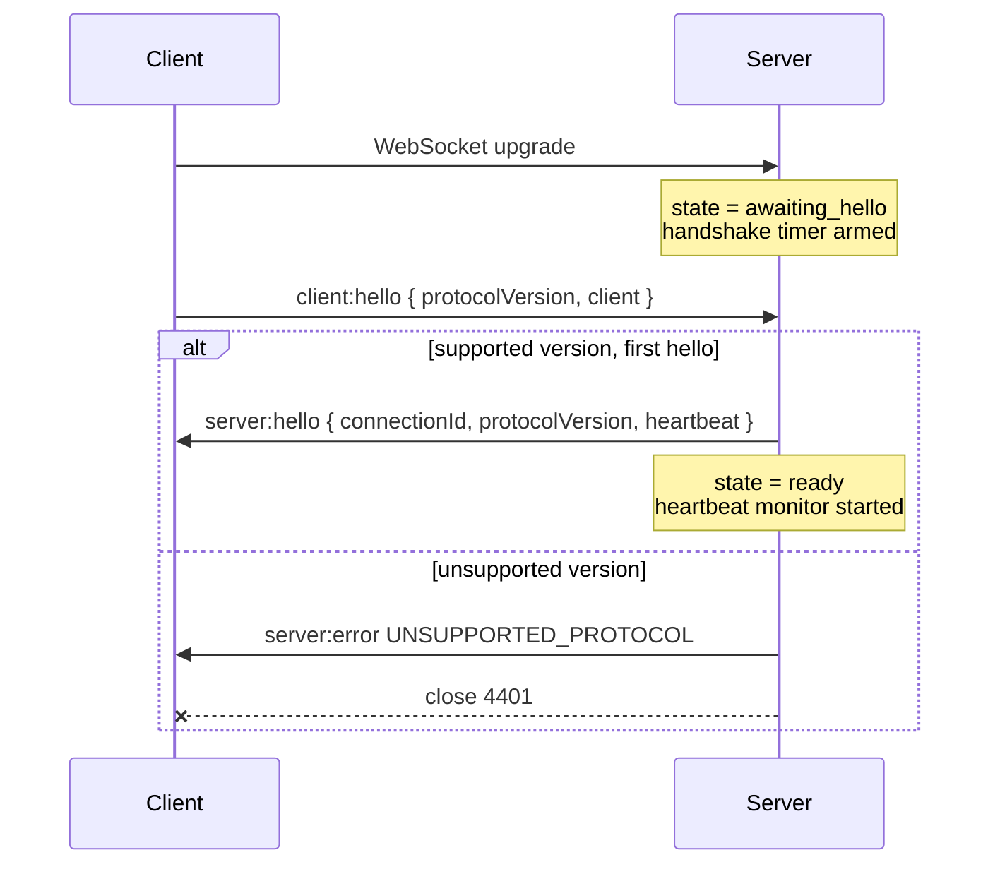
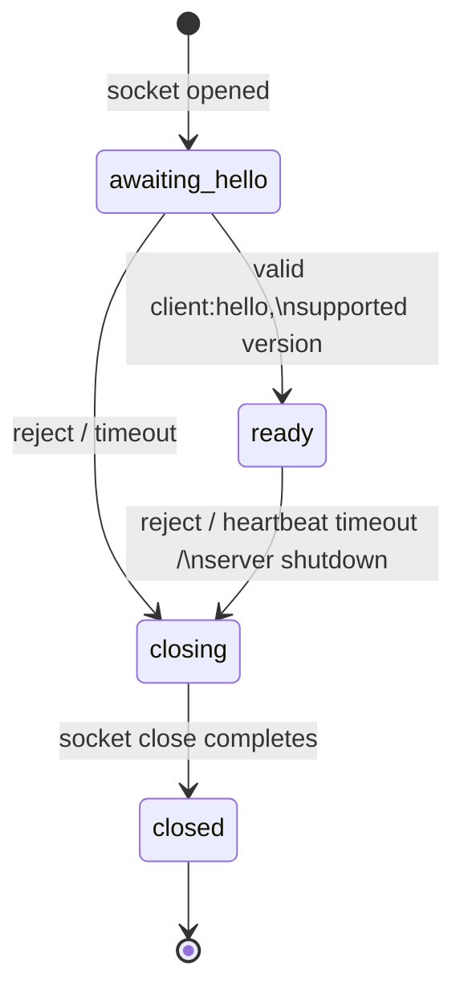

# Realtime protocol (T2)

Canonical contracts live in code at [`packages/protocol/src/`](../../packages/protocol/src/); this
document explains the design and is not itself authoritative — the schemas are. See
[`docs/ARCHITECTURE.md`](../ARCHITECTURE.md) for how `services/realtime` fits the wider system and
[`docs/tasks/T2_REALTIME_PROTOCOL.md`](../tasks/T2_REALTIME_PROTOCOL.md) for the task that
implemented this.

## Scope

T2 defines the connection/handshake/liveness foundation only: `client:hello`, `client:ping`,
`server:hello`, `server:pong`, `server:error`. It carries no presence, signaling, voice, text, or
authentication semantics — those are later tasks building on this same envelope and versioning
strategy (see [Future extension](#future-extension)).

## Transport

- Local development and automated tests use plain `ws://` on `127.0.0.1`.
- Production must terminate TLS in front of the service:

  ```text
  Desktop client
        |
        |  wss://
        v
  TLS reverse proxy / service boundary
        |
        |  ws:// (localhost or private network)
        v
  services/realtime
  ```

  This server does not implement TLS itself; that is a self-hosting/deployment concern (later
  hardening task), not a T2 concern.

- Media (audio/video) **never** traverses this service. It carries only control/signaling-shaped
  JSON text messages.
- Binary WebSocket frames are not supported and are rejected (`INVALID_MESSAGE`); every message is
  UTF-8 JSON text.

## Message envelope

There is no generic `{ action, data }` wrapper and no separate "envelope" object nested around a
`payload` field. Every message is its own fully-typed schema, discriminated by a `type` field, with
its specific fields directly on the message — an envelope layer would add indirection without
adding safety, since each message is already precisely typed.

Every message (both directions) carries:

| Field  | Meaning                                                     |
| ------ | ----------------------------------------------------------- |
| `type` | Discriminant, e.g. `"client:hello"`, `"server:pong"`        |
| `id`   | Chosen by whichever side originates the message (see below) |

**Correlation rule:** a direct response to a specific message echoes that message's `id` rather
than minting a separate `replyTo` field — free request/response correlation for the common case.
`server:error` is the one exception: the rejected input may not have parsed far enough to have a
usable `id` (invalid JSON, wrong shape), so it always carries a fresh server-generated `id`, plus
an optional `replyTo` when the offending message's `id` could be recovered.

`protocolVersion` is **not** repeated on every message. It is only present on `client:hello` and
`server:hello` — see [Versioning](#versioning) for why.

## Versioning

```ts
CURRENT_PROTOCOL_VERSION = 1;
SUPPORTED_PROTOCOL_VERSIONS = [1];
```

A WebSocket connection's protocol version cannot change mid-connection, so it is negotiated exactly
once during the handshake rather than repeated on every message. `client:hello.protocolVersion` is
structurally just a positive integer — an unrecognized version is not a schema failure, it's a
distinct, specifically-coded `UNSUPPORTED_PROTOCOL` failure, checked against
`SUPPORTED_PROTOCOL_VERSIONS` after the message otherwise parses successfully.

**Evolution strategy:** additive, backward-compatible changes (new message types, new optional
fields) do not require a version bump. A breaking change (removing/renaming a field, changing a
field's meaning, tightening a constraint an existing client relies on) increments
`CURRENT_PROTOCOL_VERSION` and adds the new value to `SUPPORTED_PROTOCOL_VERSIONS`; the server may
support more than one version at once during a migration window. A client requesting a version
outside `SUPPORTED_PROTOCOL_VERSIONS` always receives `UNSUPPORTED_PROTOCOL` and the connection is
closed — a defined failure, never undefined behavior.

## Handshake



A newly-opened socket is not an accepted application connection. It starts `awaiting_hello`; the
**only** message it may send is `client:hello`. Anything else (including a valid `client:ping`)
gets `HANDSHAKE_REQUIRED` and the socket is closed. A client that never sends `client:hello` within
`REALTIME_HANDSHAKE_TIMEOUT_MS` (default `5000`) is closed with `HANDSHAKE_TIMEOUT` — idle
unauthenticated sockets are never left open indefinitely.

`server:hello` carries only what proves negotiation succeeded and lets the client behave correctly:
its own `connectionId`, the negotiated `protocolVersion`, `serverTime`, and the heartbeat cadence.
No speculative product/presence state.

## Connection identity

Each accepted connection gets a server-generated `connectionId` (`crypto.randomUUID()`):

- unique for the process lifetime, not user-controlled, safe to log;
- **not** an authentication or authorization signal — T2 has no account/session system. A future
  task that adds identity will associate it _with_ a connection, not derive it _from_ one.

## Connection state machine



`awaiting_hello` merges what could be split into "socket connected" and "awaiting hello" — the
implementation only ever observes a connection once its WebSocket upgrade is already complete, so
there is no independently-actionable state in between. There is deliberately no separate state per
rejection reason (bad hello, unsupported version, rate limited, ...) — every rejection follows the
same `awaiting_hello`/`ready` → `closing` → `closed` path, with the reason recorded once as data
(an error code and a WebSocket close code), not as a proliferation of connection states.

## Heartbeat / liveness

Two independent mechanisms, used deliberately for different purposes:

- **Server-driven, WebSocket protocol-level ping/pong** (`REALTIME_HEARTBEAT_INTERVAL_MS` /
  `REALTIME_HEARTBEAT_TIMEOUT_MS`, defaults `15000`/`10000`): every interval, the server sends a
  protocol-level ping and arms a timeout; a pong before the timeout clears it, a missed pong
  terminates the connection. This is the server's own mechanism for detecting dead/half-open
  connections. A browser-like `WebSocket` client (the eventual Electron Renderer consumer) cannot
  itself originate a protocol-level ping or observe a pong — that layer is handled entirely by the
  network stack, invisible to JS — so this direction can only be server-initiated.
- **Client-driven, application-level `client:ping` / `server:pong`**: available any time after
  `ready`. This is the only way client-side code can proactively verify liveness or measure
  round-trip time for itself, since it cannot originate a protocol-level ping. Useful later for a
  "connection quality" indicator; T2 only proves the round trip works.

## Errors

| Code                   | Meaning                                                                        | Close code |
| ---------------------- | ------------------------------------------------------------------------------ | ---------: |
| `INVALID_MESSAGE`      | Malformed JSON, schema violation, unknown `type`, or a binary frame            |       4400 |
| `UNSUPPORTED_PROTOCOL` | `client:hello.protocolVersion` not in `SUPPORTED_PROTOCOL_VERSIONS`            |       4401 |
| `HANDSHAKE_REQUIRED`   | A non-hello message arrived before the handshake completed                     |       4402 |
| `HANDSHAKE_TIMEOUT`    | The client never completed the handshake in time                               |       4403 |
| `UNEXPECTED_MESSAGE`   | Structurally valid, but not allowed in the current state (duplicate hello)     |       4404 |
| `RATE_LIMITED`         | Per-connection message rate limit exceeded                                     |       4429 |
| `MESSAGE_TOO_LARGE`    | Documented for protocol completeness — see the note below                      |       1009 |
| `INTERNAL_ERROR`       | Unexpected server-side failure handling an otherwise-valid message             |       4500 |
| `SERVER_AT_CAPACITY`   | `REALTIME_MAX_CONNECTIONS` already reached; rejected before any handshake work |       4503 |

**Policy: every rejection results in a `server:error` (when the socket can still be written to)
followed immediately by connection close.** T2 has no "warn and continue" path — its protocol
surface is small enough that a well-behaved client should never trigger these cases in normal
operation, so simplicity wins over trying to gracefully recover a connection that already violated
the protocol.

**`MESSAGE_TOO_LARGE` is the one exception to "error then close".** The maximum message size
(`REALTIME_MAX_MESSAGE_BYTES`, default `16384` bytes) is enforced by the WebSocket library itself
(`ws`'s `maxPayload`) before the oversized frame can be parsed, terminating the connection
immediately with the standard WebSocket close code `1009`. There is no chance to send a graceful
`server:error` for this one case — the code is still defined in the protocol for documentation and
future-transport completeness.

Client-facing errors never include stack traces or other server-internal detail — `message` is a
short, fixed, human-readable string per code. Diagnostic detail belongs in server logs only, keyed
by `connectionId`.

**An unexpected exception in message handling is contained to the one connection that triggered
it.** Everything past schema validation in `Connection.handleRawMessage` runs inside a `try/catch`;
an unhandled throw there produces `INTERNAL_ERROR` for that connection instead of propagating —
this is a single Node process shared by every connected client, so an uncaught exception would
otherwise crash the whole service, not just the offending connection. `index.ts` also installs a
last-resort `uncaughtException`/`unhandledRejection` handler (logs and exits) for a failure outside
that boundary, since Node's own guidance is that resuming after `uncaughtException` is not safe.

## Size, rate, and connection limits

| Setting                            | Default | Purpose                                                         |
| ---------------------------------- | ------: | --------------------------------------------------------------- |
| `REALTIME_MAX_CONNECTIONS`         |    1000 | Maximum concurrent connections; new ones are rejected past this |
| `REALTIME_MAX_MESSAGE_BYTES`       |  16 KiB | Maximum inbound WebSocket frame size (`ws`'s `maxPayload`)      |
| `REALTIME_HANDSHAKE_TIMEOUT_MS`    |    5000 | Time allowed to send `client:hello` after connecting            |
| `REALTIME_HEARTBEAT_INTERVAL_MS`   |   15000 | Interval between server-initiated protocol-level pings          |
| `REALTIME_HEARTBEAT_TIMEOUT_MS`    |   10000 | Grace period for a pong before a connection is declared dead    |
| `REALTIME_RATE_LIMIT_MAX_MESSAGES` |      30 | Messages allowed per connection per rate-limit window           |
| `REALTIME_RATE_LIMIT_WINDOW_MS`    |   10000 | Rate-limit window length                                        |

The rate limiter is a lightweight fixed-window counter **per connection**, not a distributed or
cross-connection limiter — T2's threat model for it is one connected client flooding the Node event
loop, not coordinated abuse across many connections. Exceeding it is `RATE_LIMITED`, handled by the
same error-then-close policy as everything else.

`REALTIME_MAX_CONNECTIONS` is the complementary control for _many_ connections: past this many
concurrently tracked connections, a new one is rejected — `server:error SERVER_AT_CAPACITY` then
close `4503` — before any `Connection` (timers, rate limiter, heartbeat) is created for it, so a
rejected connection costs the server nothing beyond accepting and immediately closing the socket.
This is a per-process cap, not a per-source-IP one; a determined single source can still open many
connections up to the cap. A production deployment fronted by a reverse proxy (see
[Transport](#transport)) can add IP-based limits at that layer — T2 does not implement that itself.

## Security assumptions

- Every inbound message is runtime-validated (`packages/protocol`, via `zod`) before any domain
  code sees it — a compile-time TypeScript type alone is never trusted for network input.
- `connectionId` is not an identity or authorization signal; T2 has no authentication.
- Errors sent to clients never leak internals; logs may contain diagnostic detail but never raw
  message payloads, secrets, or (in future tasks) credentials/SDP.
- One connection cannot exhaust the process via message size or message rate — both are bounded
  and configurable, validated at startup (invalid configuration fails the process immediately with
  a clear error, per [`docs/CONFIGURATION.md`](../CONFIGURATION.md)).
- The service still requires a TLS-terminating boundary in front of it for any non-local
  deployment; T2 does not implement or claim that.

## Future extension

The envelope and versioning strategy are designed so later tasks can add message types without
redesigning the foundation — for example (not implemented in T2):

```text
T3  voice:join, voice:leave, webrtc:offer, webrtc:answer, webrtc:ice-candidate
T7  text:join, text:message-send, text:message-created
```

Each new message type is its own schema added to the relevant discriminated union in
`packages/protocol`, following the same rules: bounded fields, an explicit direction, and coverage
by the same `error-then-close` policy for anything that fails validation. Presence beyond raw
connection lifecycle ("a socket is connected" is not "a user is online") and authentication/session
identity are explicitly out of scope until a task introduces an account model.
