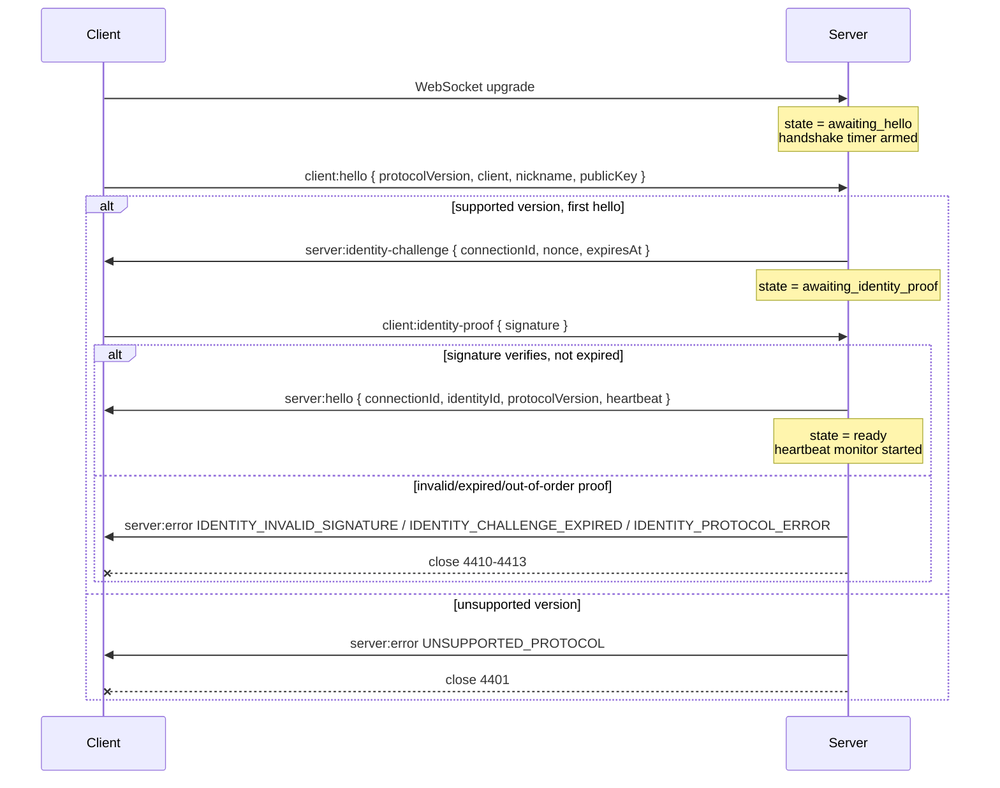
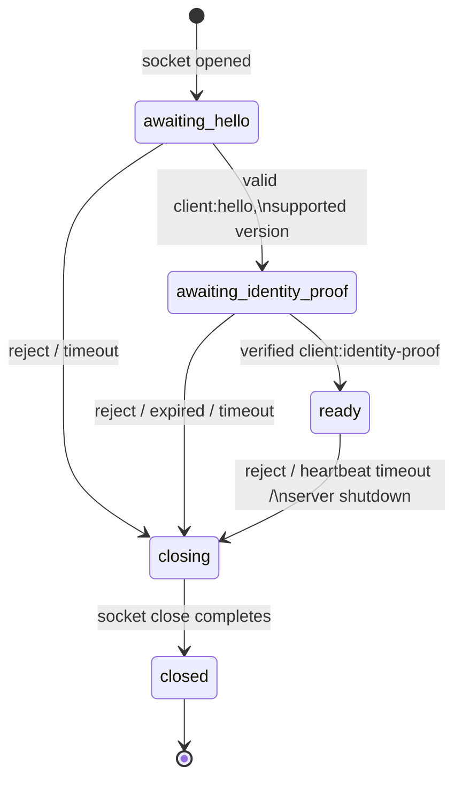

# Realtime protocol (T2, extended by T7, T8, T9, T10)

Canonical contracts live in code at [`packages/protocol/src/`](../../packages/protocol/src/); this
document explains the design and is not itself authoritative — the schemas are. See
[`docs/ARCHITECTURE.md`](../ARCHITECTURE.md) for how `services/realtime` fits the wider system,
[`docs/tasks/T2_REALTIME_PROTOCOL.md`](../tasks/T2_REALTIME_PROTOCOL.md) for the task that
implemented the connection foundation this document covers,
[`WEBRTC_VOICE.md`](WEBRTC_VOICE.md) / [`docs/tasks/T3_VOICE_WEBRTC.md`](../tasks/T3_VOICE_WEBRTC.md)
for the voice/WebRTC signaling this foundation now also carries,
[`CLIENT_IDENTITY.md`](CLIENT_IDENTITY.md) / [`docs/tasks/T7_LOCAL_IDENTITY.md`](../tasks/T7_LOCAL_IDENTITY.md)
for the local-cryptographic-identity handshake this document now also covers,
[`DEDICATED_SERVER.md`](DEDICATED_SERVER.md) / [`docs/tasks/T8_DEDICATED_SERVER.md`](../tasks/T8_DEDICATED_SERVER.md)
for T8's server-metadata/channel-discovery additions to this same handshake,
[`SERVER_AUTHORIZATION.md`](SERVER_AUTHORIZATION.md) / [`docs/tasks/T9_SERVER_AUTHORIZATION.md`](../tasks/T9_SERVER_AUTHORIZATION.md)
for T9's server-local admission/groups/tokens/bans message surface, and
[`PERSISTENT_TEXT_CHAT.md`](PERSISTENT_TEXT_CHAT.md) / [`docs/tasks/T10_PERSISTENT_TEXT_CHAT.md`](../tasks/T10_PERSISTENT_TEXT_CHAT.md)
for T10's persistent chat message surface — both T9 and T10 are covered here only at the
envelope/handshake-placement level; the design itself lives in those documents.

## Scope

This document covers the connection/handshake/liveness envelope T2 defined (`client:hello`,
`client:ping`, `server:hello`, `server:pong`, `server:error`), T7's identity-proof step inserted
into that same handshake (`server:identity-challenge`, `client:identity-proof`), T8's server-
identity fields added to `server:hello` (`serverName`, `serverCapabilities`), T9's admission step
and `client:authorization-*`/`server:authorization-*` message family, and T10's
`client:chat-*`/`server:chat-*` message family — all layered on top of the same handshake and
envelope. Voice signaling (`voice:*`, `webrtc:*`) was added in T3 on top of this same envelope and
versioning strategy without changing it — see [`WEBRTC_VOICE.md`](WEBRTC_VOICE.md) for that message
surface's own design.

## Transport

- Local development and automated tests use plain `ws://` on `127.0.0.1`.
- Production must terminate TLS in front of the service:

  ```text
  Desktop client
        |
        |  wss://
        v
  TLS reverse proxy / service boundary
        |
        |  ws:// (localhost or private network)
        v
  services/realtime
  ```

  This server does not implement TLS itself; that is a self-hosting/deployment concern (later
  hardening task), not a T2 concern.

- Media (audio/video) **never** traverses this service. It carries only control/signaling-shaped
  JSON text messages.
- Binary WebSocket frames are not supported and are rejected (`INVALID_MESSAGE`); every message is
  UTF-8 JSON text.

## Message envelope

There is no generic `{ action, data }` wrapper and no separate "envelope" object nested around a
`payload` field. Every message is its own fully-typed schema, discriminated by a `type` field, with
its specific fields directly on the message — an envelope layer would add indirection without
adding safety, since each message is already precisely typed.

Every message (both directions) carries:

| Field  | Meaning                                                     |
| ------ | ----------------------------------------------------------- |
| `type` | Discriminant, e.g. `"client:hello"`, `"server:pong"`        |
| `id`   | Chosen by whichever side originates the message (see below) |

**Correlation rule:** a direct response to a specific message echoes that message's `id` rather
than minting a separate `replyTo` field — free request/response correlation for the common case.
`server:error` is the one exception: the rejected input may not have parsed far enough to have a
usable `id` (invalid JSON, wrong shape), so it always carries a fresh server-generated `id`, plus
an optional `replyTo` when the offending message's `id` could be recovered.

`protocolVersion` is **not** repeated on every message. It is only present on `client:hello` and
`server:hello` — see [Versioning](#versioning) for why.

## Versioning

```ts
CURRENT_PROTOCOL_VERSION = 4;
SUPPORTED_PROTOCOL_VERSIONS = [4];
```

Bumped 1 → 2 for T7: `client:hello` gained required `nickname`/`publicKey` fields and the
handshake gained a mandatory identity-challenge/proof step before `server:hello`. This is a
breaking change (a v1 hello is no longer sufficient to reach `ready`), so v1 support was dropped
rather than kept as a parallel unauthenticated codepath — maintaining it would have meant either
bypassing identity verification for v1 clients or having v1 always fail, neither worth keeping as
"support."

Bumped 2 → 3 for T8: `server:hello` gained required `serverName`/`serverCapabilities` fields so a
client learns which Dedicated Server it just authenticated to and what product capabilities it
offers, without a second, parallel HTTP API — see [`DEDICATED_SERVER.md`](DEDICATED_SERVER.md)'s
"Server metadata handshake" section. Adding a required field to an existing `.strict()`-validated
message is a breaking change under this document's own evolution policy (below) even though no
existing field's meaning changed, so v2 support was dropped rather than kept as a parallel
codepath — the same reasoning T7's own bump already applied.

**Not bumped for T9** — the first task to actually exercise the "additive, no bump" half of the
evolution policy below, rather than the "required field, bump" half T7 and T8 both needed. Every
T9 wire change is genuinely additive: `client:hello` gained only an _optional_ `serverToken` field
(a server in `accessMode: open`, the default, never requires it), `voiceParticipantSchema` gained
only an _optional_ `groups` badge array, and every other T9 concept (admission, groups, tokens,
bans) is a brand-new message type added to the existing discriminated unions, never a change to an
existing message's required shape. A pre-T9 client omitting `serverToken` still completes the
handshake exactly as before against an `open` server; it only fails admission (`INVITE_REQUIRED`)
against an operator-configured `invite-only` server, which is a product/configuration outcome, not
a protocol-version mismatch.

**Not bumped for T10 either** — the entire persistent-chat message family
(`client:chat-send`/`client:chat-history-request`, `server:chat-message`/`server:chat-history-page`)
is a set of brand-new message types, and `serverCapabilitySchema` gained an additive `'text-chat'`
enum member. No existing message's required shape changed.

Bumped 3 → 4 for T13.2: `voice:catalog` changed shape from a flat `channels: VoiceChannelSummary[]` to
a per-connection-filtered `nodes: ChannelNodeView[]` tree, with no parallel old field kept alongside
it — an old client's `.strict()` parser would reject the new shape outright (`channels` is gone), so
this is a genuine breaking change, not additive, exactly like T7's v1→v2 bump. v3 support was dropped
rather than kept as a parallel codepath, matching that same precedent. Every other T13.2 wire change
(the full `client:channel-*`/`server:channel-*` message family, `server:voice-removed-by-policy`) is a
brand-new message type added to the existing discriminated unions and needed no bump of its own — see
[`CHANNELS_AND_SERVER_ADMINISTRATION.md`](CHANNELS_AND_SERVER_ADMINISTRATION.md) for the full design.

**Not bumped for T13.3 either** — the entire profile/avatar/presence message family (six new
`client:profile-*` messages, five new `server:*` messages), `server:hello`'s new optional
`serverAvatarRef` field, and `server:presence-snapshot`'s later-added optional `selfMemberRef` field
are all additive. No existing message's required shape changed. See
[`SERVER_LOCAL_PROFILES_AND_PRESENCE.md`](SERVER_LOCAL_PROFILES_AND_PRESENCE.md) for the full
message-family design. One non-schema behavioral change worth noting here: a connection's initial
reply burst at `ready` grew from four messages (`server:hello`, `server:authorization-state`,
`voice:catalog`, `server:presence-snapshot`) to five — `handleIdentityProof` now also proactively
pushes one `server:profile-self-updated` carrying the identity's real persisted profile, closing a
gap where a returning user's own avatar/status/presence was otherwise invisible until their next
mutation. This is not a protocol-version concern (an old client simply receives one additional
message of a type it may not recognize; `.strict()` schema validation is per-message, not per-burst),
but any code — test helper or otherwise — that drains a _fixed count_ of a connection's initial
messages needs to account for the new count.

A WebSocket connection's protocol version cannot change mid-connection, so it is negotiated exactly
once during the handshake rather than repeated on every message. `client:hello.protocolVersion` is
structurally just a positive integer — an unrecognized version is not a schema failure, it's a
distinct, specifically-coded `UNSUPPORTED_PROTOCOL` failure, checked against
`SUPPORTED_PROTOCOL_VERSIONS` after the message otherwise parses successfully.

**Evolution strategy:** additive, backward-compatible changes (new message types, new optional
fields) do not require a version bump. A breaking change (removing/renaming a field, changing a
field's meaning, tightening a constraint an existing client relies on) increments
`CURRENT_PROTOCOL_VERSION` and adds the new value to `SUPPORTED_PROTOCOL_VERSIONS`; the server may
support more than one version at once during a migration window. A client requesting a version
outside `SUPPORTED_PROTOCOL_VERSIONS` always receives `UNSUPPORTED_PROTOCOL` and the connection is
closed — a defined failure, never undefined behavior.

## Handshake



A newly-opened socket is not an accepted application connection. It starts `awaiting_hello`; the
**only** message it may send is `client:hello`. Anything else (including a valid `client:ping`)
gets `HANDSHAKE_REQUIRED` and the socket is closed. A structurally valid, supported-version hello
moves the connection to `awaiting_identity_proof` and issues a challenge — see
[`CLIENT_IDENTITY.md`](CLIENT_IDENTITY.md) for the full T7 identity design (canonical signing
payload, domain separation, replay/expiry handling). The connection is not `ready` — cannot join
voice, signal, or do anything else — until a verified `client:identity-proof` arrives. A client
that never completes _either_ step (hello, or the identity proof after it) within
`REALTIME_HANDSHAKE_TIMEOUT_MS` (default `5000`) is closed with `HANDSHAKE_TIMEOUT` — idle
unauthenticated sockets are never left open indefinitely, regardless of which half of the
now-two-step handshake they stalled in.

**T9 — admission is checked inside the same identity-proof step, strictly before `ready`.** Once
the signature verifies (authentication succeeds), the server evaluates server-local authorization
(`AuthorizationPort.admit`, see [`SERVER_AUTHORIZATION.md`](SERVER_AUTHORIZATION.md)) before
building `server:hello` at all. A banned identity or an identity that cannot satisfy an
`invite-only` server's admission rules never receives `server:hello` and never reaches `ready` —
`server:error` (`BANNED` / `INVITE_REQUIRED`) then close, the same error-then-close policy as any
other handshake rejection. This is deliberate: authentication (who you are) and authorization
(whether this server currently admits you) are distinct checks, but the wire never exposes a state
between them — a connection is either still proving its identity, or it is `ready` _and_ admitted,
never "authenticated but not yet authorized." On success, `server:hello` is followed by a
`server:authorization-state` reply (the connecting identity's own groups/permissions on _this_
server) and then `voice:catalog`, in that order.

`server:hello` carries only what proves negotiation succeeded and lets the client behave correctly:
its own `connectionId`, the server-verified `identityId`, the negotiated `protocolVersion`,
`serverTime`, the heartbeat cadence, and (T8) the server's own display `serverName` and bounded
`serverCapabilities` list — still no speculative product/presence state beyond that: no channel
membership, no participant list (that remains `voice:catalog`'s job), and no group/permission data
(that is `server:authorization-state`'s job, sent right after).

## Connection identity

Each accepted connection gets a server-generated `connectionId` (`crypto.randomUUID()`):

- unique for the process lifetime, not user-controlled, safe to log;
- **not** an authentication or authorization signal by itself — it identifies a _connection_, not a
  _client_. `identityId` (T7) is the authentication signal: server-derived from the client's
  verified public key, stable across reconnects for the same local identity. The two remain
  distinct concepts on the wire and are never merged — see
  [`CLIENT_IDENTITY.md`](CLIENT_IDENTITY.md)'s "connectionId / identityId / participantId" section.

## Connection state machine



`awaiting_hello` merges what could be split into "socket connected" and "awaiting hello" — the
implementation only ever observes a connection once its WebSocket upgrade is already complete, so
there is no independently-actionable state in between. `awaiting_identity_proof` (T7) is the one
addition since T2: a connection that sent a structurally valid hello but has not yet proven
possession of the private key matching its claimed public key. There is deliberately no separate
state per rejection reason (bad hello, unsupported version, rate limited, invalid signature, ...) —
every rejection follows the same `awaiting_hello`/`awaiting_identity_proof`/`ready` → `closing` →
`closed` path, with the reason recorded once as data (an error code and a WebSocket close code),
not as a proliferation of connection states.

## Heartbeat / liveness

Two independent mechanisms, used deliberately for different purposes:

- **Server-driven, WebSocket protocol-level ping/pong** (`REALTIME_HEARTBEAT_INTERVAL_MS` /
  `REALTIME_HEARTBEAT_TIMEOUT_MS`, defaults `15000`/`10000`): every interval, the server sends a
  protocol-level ping and arms a timeout; a pong before the timeout clears it, a missed pong
  terminates the connection. This is the server's own mechanism for detecting dead/half-open
  connections. A browser-like `WebSocket` client (the eventual Electron Renderer consumer) cannot
  itself originate a protocol-level ping or observe a pong — that layer is handled entirely by the
  network stack, invisible to JS — so this direction can only be server-initiated.
- **Client-driven, application-level `client:ping` / `server:pong`**: available any time after
  `ready`. This is the only way client-side code can proactively verify liveness or measure
  round-trip time for itself, since it cannot originate a protocol-level ping. Useful later for a
  "connection quality" indicator; T2 only proves the round trip works.

## Errors

| Code                          | Meaning                                                                                                                  | Close code |
| ----------------------------- | ------------------------------------------------------------------------------------------------------------------------ | ---------: |
| `INVALID_MESSAGE`             | Malformed JSON, schema violation, unknown `type`, or a binary frame                                                      |       4400 |
| `UNSUPPORTED_PROTOCOL`        | `client:hello.protocolVersion` not in `SUPPORTED_PROTOCOL_VERSIONS`                                                      |       4401 |
| `HANDSHAKE_REQUIRED`          | A non-hello message arrived before the handshake completed                                                               |       4402 |
| `HANDSHAKE_TIMEOUT`           | The client never completed the handshake in time                                                                         |       4403 |
| `UNEXPECTED_MESSAGE`          | Structurally valid, but not allowed in the current state (duplicate hello)                                               |       4404 |
| `RATE_LIMITED`                | Per-connection message rate limit exceeded                                                                               |       4429 |
| `MESSAGE_TOO_LARGE`           | Documented for protocol completeness — see the note below                                                                |       1009 |
| `IDENTITY_INVALID_PUBLIC_KEY` | `client:hello.publicKey` could not be processed (defensive; schema validation already rejects malformed shapes)          |       4410 |
| `IDENTITY_INVALID_SIGNATURE`  | `client:identity-proof.signature` does not verify — covers wrong-key, tampered-payload, and replayed/copied proofs alike |       4411 |
| `IDENTITY_CHALLENGE_EXPIRED`  | The proof arrived after the challenge's `expiresAt`                                                                      |       4412 |
| `IDENTITY_PROTOCOL_ERROR`     | An identity message arrived with no outstanding challenge for the connection                                             |       4413 |
| `INTERNAL_ERROR`              | Unexpected server-side failure handling an otherwise-valid message                                                       |       4500 |
| `SERVER_AT_CAPACITY`          | `REALTIME_MAX_CONNECTIONS` already reached; rejected before any handshake work                                           |       4503 |
| `BANNED` (T9)                 | The identity is banned from this server (checked during the identity-proof step, before `ready`)                         |       4421 |
| `INVITE_REQUIRED` (T9)        | Admission-time rejection on an `invite-only` server: missing/unusable token, or (moderation) no admission basis left     |       4420 |
| `KICKED` (T9)                 | An administrator closed this connection via `client:authorization-kick`; creates no ban                                  |       4422 |

T9 also added eight **non-fatal** authorization error codes with no entry in `CLOSE_CODE_BY_ERROR`
(`AUTHORIZATION_DENIED`, `GROUP_NOT_FOUND`, `PROTECTED_GROUP`, `LAST_ADMIN`, `TOKEN_INVALID`,
`TOKEN_EXPIRED`, `TOKEN_ALREADY_USED`, `PARTICIPANT_NOT_FOUND`) — these follow T3's existing
non-fatal precedent (see [Future extension](#future-extension)): a Guest denied an admin action, or
a wrong privilege-key guess after `ready`, gets `server:error` but stays connected. See
[`SERVER_AUTHORIZATION.md`](SERVER_AUTHORIZATION.md) for the full authorization message surface,
per-code semantics, and why `INVITE_REQUIRED` (not `AUTHORIZATION_DENIED`) is the fatal code used
when a live connection is force-closed for no longer having an admission basis (T9 Section 63).

T10 added one more **non-fatal** code, `CHAT_RATE_LIMITED` — a connection exceeding its
chat-specific send/history-request rate-limit buckets (separate from the generic transport-level
`RATE_LIMITED` above) stays connected, matching every other rate-limit-shaped non-fatal condition.
See [`PERSISTENT_TEXT_CHAT.md`](PERSISTENT_TEXT_CHAT.md) for the full chat message surface.

T13.2 added seven more **non-fatal** codes the same way (`CHANNEL_ACCESS_DENIED`,
`CHANNEL_PASSWORD_REQUIRED`, `CHANNEL_PASSWORD_INVALID`, `CHANNEL_PASSWORD_RATE_LIMITED`,
`CHANNEL_PARENT_INVALID`, `CHANNEL_TREE_LIMIT_EXCEEDED`, `GROUP_IN_USE_BY_CHANNEL_POLICY`), plus reuse
of the existing `CHANNEL_NOT_FOUND`/`CHANNEL_FULL` codes unchanged from their T3 meanings — a hidden
channel and a nonexistent one are structurally indistinguishable by design, so a hidden channel
returns the same `CHANNEL_NOT_FOUND` a genuinely unknown ID always has, never a new, more specific
code that would itself leak the channel's existence. See
[`CHANNELS_AND_SERVER_ADMINISTRATION.md`](CHANNELS_AND_SERVER_ADMINISTRATION.md) for the full channel
message surface and ACL/password semantics.

T13.3 added seven more **non-fatal** codes the same way (`AVATAR_TOO_LARGE`,
`AVATAR_INVALID_FORMAT`, `AVATAR_DIMENSIONS_TOO_LARGE`, `AVATAR_ANIMATED_NOT_ALLOWED`,
`CUSTOM_STATUS_TOO_LONG`, `PROFILE_RATE_LIMITED`, `MEMBER_NOT_FOUND`) — a rejected avatar upload,
an over-length status, a rate-limited profile mutation, or a `memberRef` naming a currently-offline
member all leave the connection open. `AVATAR_ANIMATED_NOT_ALLOWED` is deliberately distinct from
`AVATAR_DIMENSIONS_TOO_LARGE` so client-side copy can say "animated images aren't allowed" rather
than the factually wrong "dimensions too large" for a correctly-sized animated image. See
[`SERVER_LOCAL_PROFILES_AND_PRESENCE.md`](SERVER_LOCAL_PROFILES_AND_PRESENCE.md) for the full
profile/avatar/presence message surface.

The four `IDENTITY_*` codes are deliberately coarse (see [`CLIENT_IDENTITY.md`](CLIENT_IDENTITY.md)
for the reasoning): a replayed challenge and a signature from the wrong key both surface as
`IDENTITY_INVALID_SIGNATURE` rather than distinct codes, since the state machine already makes
same-connection replay structurally impossible and cross-connection replay fails verification
anyway (the payload binds `connectionId`/`nonce`).

**Policy: every rejection results in a `server:error` (when the socket can still be written to)
followed immediately by connection close.** T2 has no "warn and continue" path — its protocol
surface is small enough that a well-behaved client should never trigger these cases in normal
operation, so simplicity wins over trying to gracefully recover a connection that already violated
the protocol.

**`MESSAGE_TOO_LARGE` is the one exception to "error then close".** The maximum message size
(`REALTIME_MAX_MESSAGE_BYTES`, default `16384` bytes) is enforced by the WebSocket library itself
(`ws`'s `maxPayload`) before the oversized frame can be parsed, terminating the connection
immediately with the standard WebSocket close code `1009`. There is no chance to send a graceful
`server:error` for this one case — the code is still defined in the protocol for documentation and
future-transport completeness.

Client-facing errors never include stack traces or other server-internal detail — `message` is a
short, fixed, human-readable string per code. Diagnostic detail belongs in server logs only, keyed
by `connectionId`.

**An unexpected exception in message handling is contained to the one connection that triggered
it.** Everything past schema validation in `Connection.handleRawMessage` runs inside a `try/catch`;
an unhandled throw there produces `INTERNAL_ERROR` for that connection instead of propagating —
this is a single Node process shared by every connected client, so an uncaught exception would
otherwise crash the whole service, not just the offending connection. `index.ts` also installs a
last-resort `uncaughtException`/`unhandledRejection` handler (logs and exits) for a failure outside
that boundary, since Node's own guidance is that resuming after `uncaughtException` is not safe.

## Size, rate, and connection limits

| Setting                              | Default | Purpose                                                         |
| ------------------------------------ | ------: | --------------------------------------------------------------- |
| `REALTIME_MAX_CONNECTIONS`           |    1000 | Maximum concurrent connections; new ones are rejected past this |
| `REALTIME_MAX_MESSAGE_BYTES`         |  16 KiB | Maximum inbound WebSocket frame size (`ws`'s `maxPayload`)      |
| `REALTIME_HANDSHAKE_TIMEOUT_MS`      |    5000 | Total time allowed to complete hello _and_ the identity proof   |
| `REALTIME_IDENTITY_CHALLENGE_TTL_MS` |   10000 | How long one issued identity challenge stays answerable         |
| `REALTIME_HEARTBEAT_INTERVAL_MS`     |   15000 | Interval between server-initiated protocol-level pings          |
| `REALTIME_HEARTBEAT_TIMEOUT_MS`      |   10000 | Grace period for a pong before a connection is declared dead    |
| `REALTIME_RATE_LIMIT_MAX_MESSAGES`   |      30 | Messages allowed per connection per rate-limit window           |
| `REALTIME_RATE_LIMIT_WINDOW_MS`      |   10000 | Rate-limit window length                                        |

The rate limiter is a lightweight fixed-window counter **per connection**, not a distributed or
cross-connection limiter — T2's threat model for it is one connected client flooding the Node event
loop, not coordinated abuse across many connections. Exceeding it is `RATE_LIMITED`, handled by the
same error-then-close policy as everything else.

`REALTIME_MAX_CONNECTIONS` is the complementary control for _many_ connections: past this many
concurrently tracked connections, a new one is rejected — `server:error SERVER_AT_CAPACITY` then
close `4503` — before any `Connection` (timers, rate limiter, heartbeat) is created for it, so a
rejected connection costs the server nothing beyond accepting and immediately closing the socket.
This is a per-process cap, not a per-source-IP one; a determined single source can still open many
connections up to the cap. A production deployment fronted by a reverse proxy (see
[Transport](#transport)) can add IP-based limits at that layer — T2 does not implement that itself.

## Security assumptions

- Every inbound message is runtime-validated (`packages/protocol`, via `zod`) before any domain
  code sees it — a compile-time TypeScript type alone is never trusted for network input.
- `connectionId` is not an identity or authorization signal; `identityId` (T7) is, and is always
  server-derived from a verified public key — never trusted as a client-supplied value.
- No connection reaches `ready` — and therefore cannot join voice, signal, or send any
  channel-scoped message — without a verified identity proof (T7).
- Errors sent to clients never leak internals; logs may contain diagnostic detail but never raw
  message payloads, secrets, private key material, or (in future tasks) credentials/SDP.
- One connection cannot exhaust the process via message size or message rate — both are bounded
  and configurable, validated at startup (invalid configuration fails the process immediately with
  a clear error, per [`docs/CONFIGURATION.md`](../CONFIGURATION.md)).
- The service still requires a TLS-terminating boundary in front of it for any non-local
  deployment; T2 does not implement or claim that.

## Future extension

The envelope and versioning strategy were designed so later tasks could add message types without
redesigning the foundation, and T3 is the first proof of that:

```text
T3   voice:join, voice:leave, voice:joined, voice:left, voice:participant-joined,
     voice:participant-left, voice:catalog, webrtc:offer, webrtc:answer,
     webrtc:ice-candidate   — implemented, see architecture/WEBRTC_VOICE.md
T7   server:identity-challenge, client:identity-proof; client:hello/server:hello extended
     with nickname/publicKey/identityId   — implemented, see architecture/CLIENT_IDENTITY.md
T8   server:hello extended with serverName/serverCapabilities; voiceChannels became
     server-owned configuration instead of a hardcoded catalog   — implemented, see
     architecture/DEDICATED_SERVER.md
T9   client:hello gained optional serverToken; voiceParticipant gained optional groups;
     12 new client:authorization-* messages, 6 new server:authorization-* messages;
     admission (BANNED/INVITE_REQUIRED) checked before ready   — implemented, see
     architecture/SERVER_AUTHORIZATION.md
T10  client:chat-send, client:chat-history-request, server:chat-message,
     server:chat-history-page; serverCapabilities gained 'text-chat'   — implemented,
     see architecture/PERSISTENT_TEXT_CHAT.md
```

T3 needed no envelope or versioning change — every new message is its own schema added to the
relevant discriminated union in `packages/protocol`, following the same rules this document already
established: bounded fields, an explicit direction, and coverage by the error-then-close policy —
**except** that T3 introduced the protocol's first genuinely **non-fatal** error codes
(`CHANNEL_NOT_FOUND`, `NOT_IN_VOICE_CHANNEL`, `SIGNALING_TARGET_INVALID`): these send a
`server:error` but do **not** close the connection, unlike every T2 error code. Whether a code is
fatal is a single lookup (`CLOSE_CODE_BY_ERROR` in `services/realtime/src/connection.ts`, a
`Partial<Record<ErrorCode, number>>` — presence of an entry means fatal) rather than a
separately-maintained flag, so this is structurally enforced rather than convention. The rationale:
T2's small protocol surface meant a well-behaved client should never trigger its errors in normal
operation, but T3's signaling errors (e.g. signaling a participant who left a moment ago — a benign
race, not misbehavior) are expected to happen during ordinary use and must not tear down the whole
voice session.

Presence beyond raw connection lifecycle ("a socket is connected" is not "a user is online" — voice
channel membership is closer to presence than T2's `connectionId` ever was) remains out of scope.
Authentication now exists (T7's identity proof), but deliberately without an account model: no
central user database, no password, no email — see [`CLIENT_IDENTITY.md`](CLIENT_IDENTITY.md) and
[`adr/0011-local-cryptographic-identity-without-central-accounts.md`](../adr/0011-local-cryptographic-identity-without-central-accounts.md).
Server-local authorization (permissions, groups, invite/privilege tokens, bans keyed by
`identityId`) is implemented as of T9 — layered strictly on top of T7's identity proof, never
replacing or weakening it: `identityId` is still the sole authentication signal, and T9 only adds
"what this identity may do _on this server_" on top of "who this identity is" — see
[`SERVER_AUTHORIZATION.md`](SERVER_AUTHORIZATION.md) and
[`adr/0013-server-authorization-storage-and-rbac.md`](../adr/0013-server-authorization-storage-and-rbac.md).
T8 made the realtime service an explicitly independently-operable product
(`services/dedicated-server`, composing this same protocol/session library unchanged) rather than
an internal-only service every test bypassed into directly — see
[`DEDICATED_SERVER.md`](DEDICATED_SERVER.md). T10 layered persistent server-side text chat on top
of this same connection/session library the identical way T9 layered authorization on top of it —
see [`PERSISTENT_TEXT_CHAT.md`](PERSISTENT_TEXT_CHAT.md).
