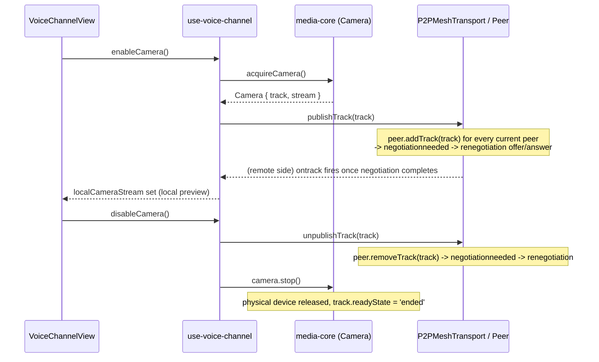

# Camera streaming (T4)

Canonical contracts live in code at [`packages/media-core/src/camera.ts`](../../packages/media-core/src/camera.ts),
[`packages/rtc-core/src/peer.ts`](../../packages/rtc-core/src/peer.ts), and
[`apps/desktop/src/renderer/voice/`](../../apps/desktop/src/renderer/voice/); this document explains
the design and is not itself authoritative. See [`WEBRTC_VOICE.md`](WEBRTC_VOICE.md) for the T3
voice/signaling foundation this builds on and [`../tasks/T4_CAMERA_STREAMING.md`](../tasks/T4_CAMERA_STREAMING.md)
for the task record including its verification status.

## Scope

Camera is a second, independent media source published over the same P2P WebRTC connections T3
already established for voice — no new transport, no new signaling channel, no new peer-connection
lifecycle. A participant can enable/disable their camera at any point while already in a voice
channel, without leaving/rejoining, and without interrupting microphone audio.

```text
Participant
│
├── microphone
│     └── audio track   (T3)
│
└── camera
      └── video track   (T4)
```

Device selection UI, screen sharing, and system audio remain out of scope — see
[`../tasks/T4_CAMERA_STREAMING.md`](../tasks/T4_CAMERA_STREAMING.md)'s Out of scope section.

## Track source model

`track.kind` (`'audio'` | `'video'`) is the source discriminator for T4 — no new `TrackSource`
metadata was introduced, since exactly one video source exists until T5 (screen sharing). The
Renderer's `use-voice-channel.ts` routes every `RemoteTrackEvent` to `remoteAudioStreams` or
`remoteVideoStreams` (two separate maps, keyed by participant id) purely by checking
`event.track.kind`.

## Camera capture

`packages/media-core/src/camera.ts`'s `acquireCamera(constraints?)` requests **video-only**
capture — `getUserMedia({ video: {...ideal}, audio: false })` — and never a microphone track;
microphone stays owned entirely by `microphone.ts`. Constraints (`width`/`height`/`frameRate`,
default 1280×720@30) are all `ideal`, matching microphone's rationale: a device that can't honor one
just captures without it. `deviceId` is accepted but never hardcoded — no picker UI exists in T4,
but the capture layer doesn't preclude adding one later. `OverconstrainedError` triggers one
fallback retry, deliberately **preserving** `deviceId` (unlike microphone's fallback, which drops
everything) — `deviceId` identifies _which_ device, not a quality trade-off, so dropping it could
silently capture from the wrong camera.

**Camera OFF always fully stops the device** (`Camera.stop()` — `track.readyState` becomes
`'ended'`), unlike microphone mute (`track.enabled = false`, device stays captured). There is no
camera "mute" concept — only acquire/stop. This is a deliberate product choice (camera light must
turn off between toggles) documented in `camera.ts` and enforced by `use-voice-channel.ts`'s
`disableCamera()`, which always calls `camera.stop()`.

## Late-acquisition race protection

Mirrors T3's real microphone-leak fix: `enableCamera()` tracks a monotonically increasing
generation counter, bumped on every enable/disable call and on effect teardown. If `getUserMedia`
resolves after the user has already disabled the camera again, left the channel, or the component
unmounted, the newly-acquired track is stopped immediately — never stored, never published. Tested
in `tests/desktop/*` and exercised live by the toggle-stress path in the camera E2E smoke.

## RTC integration: publish/unpublish, no parallel path

Camera flows through exactly the same `MediaTransport.publishTrack`/`unpublishTrack` contract
microphone already uses (`packages/rtc-core/src/p2p-mesh-transport.ts`) — no camera-specific
transport path, and no UI/hook code ever calls `peerConnection.addTrack()` directly. This design was
already correct for camera with **zero changes**, verified by inspection before any RTC-core work
began:

- **Existing peers** (camera enabled after the call is already up): `publishTrack` iterates every
  current peer and calls `peer.addTrack(track)` on each.
- **New peers** (camera was already active before someone else joins): `addParticipant` already
  seeds every currently-published track (`for (const track of this.publishedTracks) peer.addTrack(track)`)
  before creating that peer's first offer.
- **Multiple peers**: both of the above already iterate the _entire_ peer map, not one hardcoded
  peer.

## Renegotiation (the one real gap T4 found and fixed)

T3's `Peer` never listened for the platform's `negotiationneeded` event — adding/removing a track on
an already-`'connected'` peer updated local sender state but never sent a new offer, so the remote
side never learned about it. This is the one piece T4 actually needed to add to `rtc-core`.

Implemented as the standard WebRTC **"perfect negotiation"** pattern (MDN's "Establishing a perfect
negotiation" article), anchored entirely to T3's existing deterministic `role: 'initiator' |
'responder'` split — no second, independent coordination mechanism:

- `polite = (role === 'responder')`. The side that reacted to the first offer stays polite for every
  future renegotiation too; the original initiator never yields.
- `negotiated` starts `false`, flips `true` once the pair's first offer/answer cycle completes.
  `onnegotiationneeded` no-ops while `negotiated` is still `false` — the platform also fires
  `negotiationneeded` for the tracks `addParticipant` seeds _during_ initial setup, before the first
  explicit offer is even sent, and that must not race a duplicate/premature offer.
- Once `negotiated` is `true`, `onnegotiationneeded` reuses the same offer-creation logic the
  initial offer used (`createAndSendOffer`) — one code path for "the first offer" and "any later
  renegotiation."
- Collision handling: `offerCollision = makingOffer || signalingState !== 'stable'`;
  `ignoreOffer = !polite && offerCollision`. The impolite (initiator) side ignores a colliding
  inbound offer outright — its own offer wins. The polite (responder) side rolls back
  (`setLocalDescription({type:'rollback'})`) before accepting the inbound offer.

No new wire-protocol message type was needed — `webrtc:offer`/`answer`/`ice-candidate` forwarding
already exists and carries a renegotiation offer/answer exactly like the initial one.

## Camera enable/disable sequence



## Detecting a remote camera turning off: `mute`/`unmute`, not `ended`

**A real finding from this task's own E2E verification, not a design assumption:** the first
implementation listened for the remote track's `'ended'` event to detect "the far side disabled
their camera," mirroring the natural assumption that removing a sender's track ends the receiver's
corresponding track. Live two-instance testing showed this never fires — empirically, on real
Electron 43/Chromium, renegotiating a sender's track away
(`unpublishTrack` → `Peer.removeTrack` → `pc.removeTrack(sender)`) does not end the receiver's
track; it just stops delivering data. The receiving track's `readyState` stays `'live'` indefinitely.

The correct, spec-defined signal is the track's **`mute`/`unmute`** events — `track.muted` means
"temporarily unable to provide data." `use-voice-channel.ts`'s `onRemoteTrack` wires both, for video
only:

- `'mute'` → remove the participant's entry from `remoteVideoStreams` (the UI tile disappears).
- `'unmute'` → re-add it. Re-enabling a camera later typically **reuses the same transceiver** (a
  fresh `RTCPeerConnection.addTrack` call finds and reuses a stopped-sender, compatible-direction
  transceiver if one exists — this is standard, spec-defined `addTrack` behavior), so the remote
  side observes the _same_ track object fire `'unmute'` again rather than a brand-new `ontrack`
  event. Only listening for `'unmute'` (not a fresh `ontrack`) correctly reflects a second/third
  camera toggle.

Audio deliberately does **not** wire `mute`/`unmute`: microphone mute sends silence
(`track.enabled = false` on the sender) rather than stopping data flow, so the receiving audio track
does not mute — and removing the `<audio>` element on an ordinary mute would be wrong UX regardless.
Audio's only removal signal remains `'ended'` (device/track genuinely gone) or the participant
leaving the channel.

## Camera permission

`apps/desktop/src/main/permissions.ts` extends the existing narrow model: exactly `audio`-only or
`video`-only media requests, from the trusted app origin, are allowed — a request mixing both in one
`getUserMedia` call is still denied (microphone and camera are always two independent
`getUserMedia` calls, never one combined request). Every other permission kind stays default-deny.

## Local preview and remote rendering

`LocalCameraPreview.tsx` attaches the _same_ captured `MediaStream` used for publication to a muted
`<video autoPlay playsInline>` element — never a second capture just for display.
`RemoteCamera.tsx` renders one `<video>` per remote participant with an active camera, keyed by
participant id (never by arrival order), with no audio playback path of its own (remote audio stays
owned by `RemoteAudio.tsx`).

## Automated end-to-end verification

`apps/desktop/scripts/e2e-camera-smoke.mjs` extends the T3 voice smoke's pattern: two unpackaged
Electron instances join the same voice channel, both auto-enable their camera (Chromium's
`--use-fake-device-for-media-stream` provides a synthetic fake camera through the exact same switch
that provides the fake microphone — no separate flag needed), and both auto-disable it again a few
seconds later. Each instance must prove, not merely assert:

- real peer connection (`E2E_PEER_CONNECTED`);
- real non-silent decoded remote audio (`E2E_AUDIO_LEVEL_OK`, reused from T3's probe — proves voice
  is unaffected by camera);
- real decoded remote video frames, not just `ontrack` firing (`E2E_REMOTE_VIDEO_OK`, sampled from
  an offscreen `<video>` element until `videoWidth`/`videoHeight` are both positive) — explicitly
  participant-id-scoped (`e2e-video-probe.ts` refuses to probe and logs
  `E2E_REMOTE_VIDEO_MISROUTED` if the remote id ever matched the local id);
- that disabling the remote camera does **not** disconnect the peer (`E2E_REMOTE_VIDEO_ENDED:<id>:peerState=connected`
  — any other `peerState` value is treated as a failure by `main/index.ts`'s
  `armE2ECameraSmokeExit`, not a pass).

**Status: implemented and passing — three consecutive runs**, each with distinct evidence
(participant UUIDs, ports, decoded frame dimensions, audio RMS all differ run to run). See
[`../tasks/T4_CAMERA_STREAMING.md`](../tasks/T4_CAMERA_STREAMING.md) for the exact recorded values.

## Known gaps / deliberately deferred

- **Renegotiation offer atomicity — fixed in T5.** `Peer.createAndSendOffer()` used to call
  `createOffer()` then `setLocalDescription(offer)` as two separate awaited steps. T5 required this
  fixed before screen sharing added more dynamic renegotiation on top of it (screen share increases
  the odds of hitting the race). The fix and its regression test
  (`tests/rtc-core/peer.test.ts`, "the polite side handles a colliding remote offer while its own
  offer synthesis is still pending") are described in
  [`WEBRTC_SCREEN_SHARE.md`](WEBRTC_SCREEN_SHARE.md).
- No device-picker UI (architecture supports a `deviceId` constraint; T4 doesn't build the picker).
- No `RTCRtpSender.replaceTrack`-based device switching without renegotiation — T4's on/off model
  (stop + fresh `acquireCamera()`) always renegotiates; a future device-switch feature could add
  `replaceTrack` without a transport redesign.
- No TURN credential minting (same T3 gap, unaffected by camera).
- No speaking indicators, camera quality/bitrate controls, or diagnostics dashboard — explicitly out
  of T4's scope.
